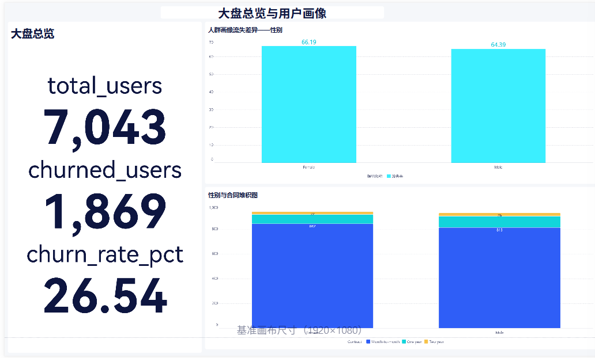
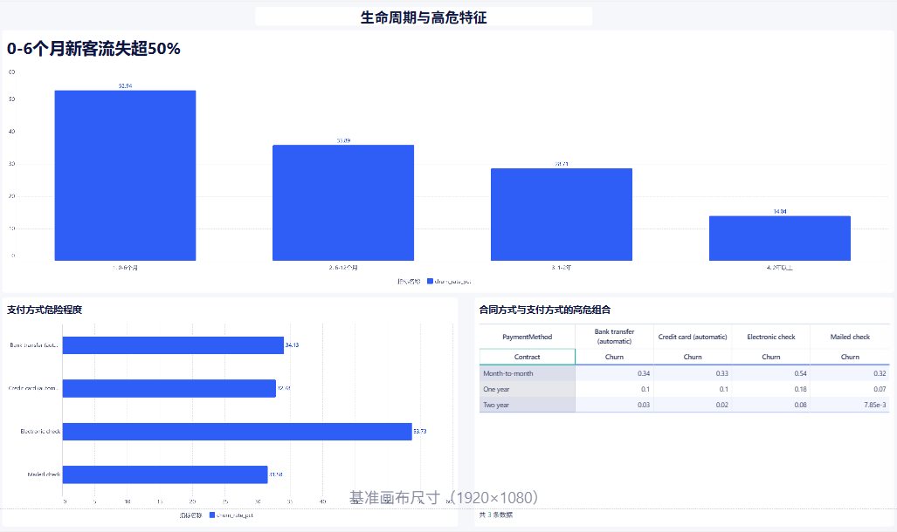
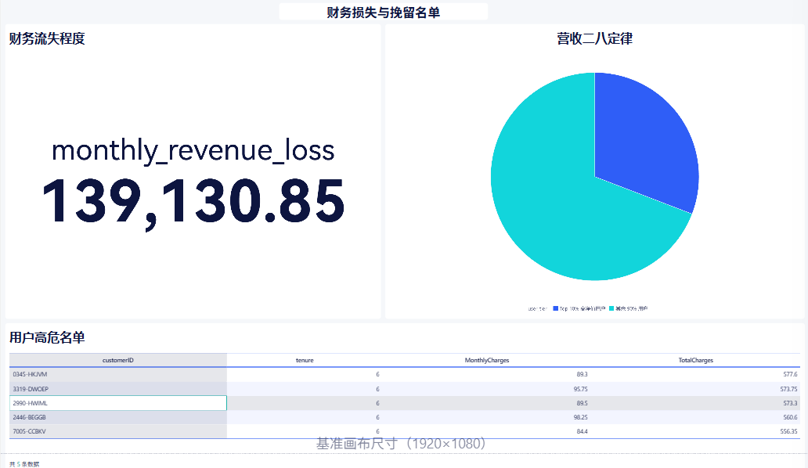
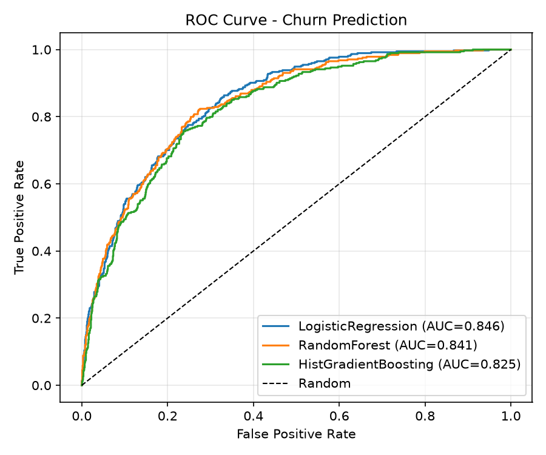
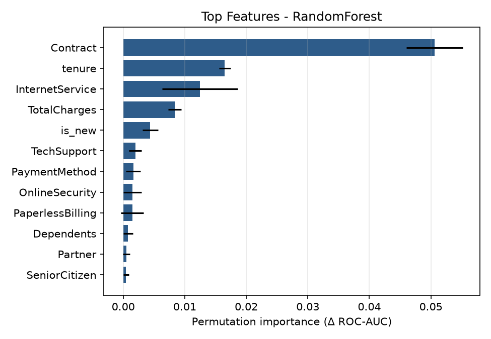

# 电信用户流失归因与挽留策略分析

用 7,043 名电信用户的公开流失数据，回答一个运营问题：**有限的挽留预算该花给谁**。
分析顺序是 SQL 诊断 → 财务量化 → 流失预测 → A/B 实验验证，代码、查询结果和图表都在仓库里。


**仓库速览**：15 条 SQL · 15 份查询结果 CSV · 3 页 BI 看板 · 3 个 notebook · 1 套流失预测模型 · 1 份 A/B 实验设计

---

## 目录

- [1. 主要结论](#1-主要结论)
- [2. 仓库结构](#2-仓库结构)
- [3. 快速开始](#3-快速开始)
- [4. 分析方法](#4-分析方法)
  - [4.1 SQL：15 条脚本](#41-sql15-条脚本)
  - [4.2 机器学习：给用户排队](#42-机器学习给用户排队)
  - [4.3 A/B 实验：验证挽留动作](#43-ab-实验验证挽留动作)
  - [4.4 BI 看板](#44-bi-看板)
- [5. 结果](#5-结果)
- [6. 工程约定](#6-工程约定)
- [7. 勘误：Q12 的单位错误](#7-勘误q12-的单位错误)
- [8. 作者](#8-作者)
- [9. 数据与许可](#9-数据与许可)

---

## 1. 主要结论

数据共 7,043 行，流失 1,869 人（**26.54%**）。下表每个数字都能在 [`results/sql/`](results/sql/) 里找到对应 CSV。

| # | 发现 | 关键数字 |
|---|---|---|
| 1 | **留存悬崖**：流失集中在入网前 6 个月 | 0–6 个月流失率 **52.94%**，首月 **62%**；2 年以上仅 14.04% |
| 2 | **高危组合**：月付 + 电子支票 | 流失率 **53.73%**，占 26.3% 用户却贡献 **53.2%** 流失人数 |
| 3 | **财务损失**：可以折算成现金流 | 每月损失 **139,130.85 元**，年化约 **167 万元**；流失用户月租比留存高 **21.5%** |
| 4 | **高价值名单**：最贵的流失不在长期合同 | One year 榜首 **8,684.8 元**，高于 Two year 的 7,856 元 |
| 5 | **长尾结构**：营收比 80/20 更平缓 | Top 10%（705 人）贡献 **30.83%** 营收；80% 营收需 **38.4%** 用户；头部单人价值是均值的 **3.8 倍** |

---

## 2. 仓库结构

```
telecom-churn-analysis/
├── sql/                     # 15 条 SQL，每条带业务注释
├── src/
│   ├── clean.py             # 清洗 + IQR 封顶 + 可选写入 MySQL
│   ├── make_demo_data.py    # 生成同构演示数据（无原始数据时跑通流水线）
│   ├── ml_churn.py          # 三模型训练 / 评估 / 阈值寻优 / 解释
│   └── abtest_analysis.py   # 功效分析 / z 检验 / 置信区间 / 分层
├── notebooks/               # 逐步分析，代码已用真实数据跑过
│   ├── 01_data_overview.ipynb
│   ├── 02_churn_drivers.ipynb
│   └── 03_modeling.ipynb
├── experiments/
│   └── abtest_design.md     # 实验设计：指标、样本量、决策规则
├── finebi/
│   ├── README.md            # 看板口径与复现步骤
│   └── dashboard_spec.md    # 15 个组件的逐条配置手册
├── docs/
│   ├── model_card.md        # 模型卡：用途、指标、阈值、局限、公平性
│   ├── report.pdf           # 初版分析报告（13 页，口径说明见第 7 节）
│   └── figures/             # 3 张 BI 看板截图
├── data/
│   ├── telco.csv            # 原始数据 7,043 × 21
│   └── README.md            # 字段字典（21 列）
├── results/
│   ├── sql/                 # 15 份查询结果 CSV
│   └── ml/                  # 模型指标、特征重要性、4 张图
└── .github/workflows/
    ├── ci.yml               # 推送即跑：SQL 校验 + 清洗 + A/B
    └── ml.yml               # 手动触发：模型训练
```

---

## 3. 快速开始

```bash
# 1) 依赖
pip install -r requirements.txt

# 2) 清洗并写入 MySQL（可选，不跑 SQL 可跳过）
python src/clean.py --data data/telco.csv --load-mysql

# 3) 跑任意一条 SQL，例如留存悬崖
mysql -u root -p churn < sql/04_retention_cliff_lifecycle.sql

# 4) 训练模型
python src/ml_churn.py --data data/telco.csv --out results/ml

# 5) A/B 实验分析
python src/abtest_analysis.py
```

需要连接 MySQL 时设置环境变量：

```powershell
$env:MYSQL_URL = "mysql+pymysql://root:密码@localhost:3306/churn?charset=utf8mb4"
```

**受限环境**（不能创建多进程管道，如部分容器）加 `--n-jobs 1`：

```bash
python src/ml_churn.py --data data/telco.csv --out results/ml --n-jobs 1
```

---

## 4. 分析方法

### 4.1 SQL：15 条脚本

脚本在 [`sql/`](sql/)，索引和业务目的见 [`sql/README.md`](sql/README.md)。按用途分四组：

| 用途 | 脚本 | 主要手法 |
|---|---|---|
| 分层与画像 | Q01–Q04 | `CASE WHEN` 分箱、`AVG(Churn)`、`GROUP BY` 交叉 |
| 归因与组合 | Q05–Q10 | `LAG` / `RANK` / `ROW_NUMBER`、CTE、自连接、`HAVING` 过滤小样本 |
| 财务量化 | Q11–Q12 | `SUM/AVG` 聚合、`NTILE` 分桶 |
| 名单与追踪 | Q13–Q15 | `DENSE_RANK`、`LEAD`、多条件 CTE |

### 4.2 机器学习：给用户排队

模型不替代归因，只负责排序——把 7,043 人按流失概率排队，让客服先打最值钱的电话。

| 环节 | 做法 |
|---|---|
| 特征 | 原始 19 列 + 4 个派生：`service_count`、`avg_monthly`、`is_new`、`charge_ratio` |
| 预处理 | 数值中位数填补 + 标准化；类别 OneHot（`min_frequency=20`） |
| 模型 | LogisticRegression（基线）/ RandomForest / HistGradientBoosting |
| 评估 | 5 折分层 CV，看 `ROC-AUC`、`PR-AUC`、`F1` |
| 阈值 | 不取 0.5，按业务收益扫描：`TP × (74.44 × 12 × 35% − 20) − FP × 20` |

真实数据结果（已入库 `results/ml/`）：

| 模型 | ROC-AUC | PR-AUC | 阈值 | Precision | Recall | 预期净收益 |
|---|---|---|---|---|---|---|
| LogisticRegression | **0.846** | 0.654 | 0.16 | 0.376 | 0.976 | **9.47 万元** |
| RandomForest | 0.841 | **0.655** | 0.10 | 0.348 | 0.976 | 9.31 万元 |
| HistGradientBoosting | 0.825 | 0.612 | 0.05 | 0.386 | 0.936 | 9.13 万元 |

按 PR-AUC 选出的最优模型是 RandomForest（0.6548），但与 LR（0.6539）几乎持平；若按预期净收益，LR 反而最高。所以选模型的指标要和业务目标一致，阈值同理。

特征重要性 Top5：`Contract`（0.051）、`tenure`（0.017）、`InternetService`（0.012）、`TotalCharges`（0.008）、`is_new`（0.004）。前三个正好对应 SQL 里 Q05/Q09、Q04、Q07 的结论，两条路径算出来的东西对得上。

模型卡（用途边界、阈值假设、局限、公平性、监控）见 [`docs/model_card.md`](docs/model_card.md)。

### 4.3 A/B 实验：验证挽留动作

设计文档见 [`experiments/abtest_design.md`](experiments/abtest_design.md)，代码 `src/abtest_analysis.py`。

- 假设：新客护航（第 7/30/60/90 天四次触达）能压低 0–6 个月流失率
- 功效分析：基线 52.94%、MDE 4pp、α=0.05、power=0.8 → 每组 2,451 人
- 分析：双样本比例 z 检验 + Wald / 自助法置信区间 + NNT + SRM 检查 + 合同分层

模拟跑出的结果（**模拟数据，仅演示统计口径**）：

| 指标 | 结果 |
|---|---|
| 对照 / 实验流失率 | 52.59% / 47.16% |
| 绝对提升 | −5.43 pp（95% CI −8.22 ~ −2.63） |
| 相对提升 | −10.32%（95% CI −15.63 ~ −5.00） |
| p 值 / NNT | 0.0001 / 18.4 |

### 4.4 BI 看板

仪表板分 3 页，构建步骤和口径见 [`finebi/README.md`](finebi/README.md)，逐组件配置见 [`finebi/dashboard_spec.md`](finebi/dashboard_spec.md)。

| 页面 | 内容 |
|---|---|
| ① 大盘总览与用户画像 | 3 个指标卡、性别流失对比、性别 × 合同堆积 |
| ② 生命周期与高危特征 | 生命周期柱状、支付方式排名、合同 × 支付矩阵 |
| ③ 财务损失与挽留名单 | MRR 损失卡、营收二八饼图、高危名单表 |

---

## 5. 结果

**① 大盘总览与用户画像**



**② 生命周期与高危特征**



**③ 财务损失与挽留名单**



**模型评估**

| ROC 曲线 | 特征重要性 |
|---|---|
|  |  |

---

## 6. 工程约定

- **口径统一**：`Churn` 为 0/1，`AVG(Churn)` 即流失率；金额单位为元
- **小样本防护**：交叉分析加 `HAVING COUNT(*) > 100`，避免长尾格子带偏结论
- **不删样本**：清洗只做回填与封顶（winsorize），保持 7,043 人的口径
- **可复现**：随机种子固定；CI 每次推送都会跑一遍数据管线
- **诚实标注**：演示数据和模拟实验在文档、代码注释里都写明了
- **CI 范围**：推送时校验 SQL 结构、清洗管线、A/B 分析；模型训练改成手动触发
  （`Actions → ml → Run workflow`），避免每次提交排队等训练

---

## 7. 勘误：Q12 的单位错误

早期版本把 `累计营收占比` 读错了单位。该字段已经乘过 100，**`0.53` 表示 0.53%，不是 53%**。
按全部 7,043 名用户重算：

| 口径 | 正确值 | 出处 |
|---|---|---|
| Top 10 名用户占营收 | **0.53%**（单人最高 0.054%） | `results/sql/q12_pareto_ntile.csv` |
| Top 1% 用户（70 人） | 3.62% | `notebooks/02_churn_drivers.ipynb` |
| **Top 10% 用户（705 人）** | **30.83%** | Q12 的 `revenue_share_pct` |
| **其余 90%（6,338 人）** | **69.17%** | Q12 第二行 |
| 覆盖 80% 营收所需用户数 | **2,702 人（38.4%）** | notebook 累计曲线 |

结论从「头部极端集中」修正为「比经典 80/20 更平缓的长尾结构」：80% 营收需要 38.4% 的用户，
不是 20%。名单制的建议仍然成立——头部单人价值 8,684.8 元，是均值 2,279.7 元的 3.8 倍，
走掉一个头部用户约等于走掉 4 个普通用户。

> 口径差异：Q12 用 `NTILE(10)` 分桶，Top 10% = 705 人；notebook 按「排名前 704 人」计算会得到
> 30.79%，0.04pp 的差别属正常口径差。
>
> `docs/report.pdf` 是初版报告，其中「发现五」的百分比标题尚未更新，
> 正确口径以本节、`results/sql/q12_pareto_ntile.csv` 为准。

---

## 8. 作者

**孟浩博**　中国人民大学 数字经济硕士（在读）· 北京理工大学 经济学学士

- GitHub：[@menghaobo0824](https://github.com/menghaobo0824)
- 邮箱：2026104662@ruc.edu.cn
- 方向：数据分析 / 用户增长，SQL + Python + BI

---

## 9. 数据与许可

- 代码：[MIT License](LICENSE)
- 数据：Telco Customer Churn（IBM Sample Data Sets），版权归数据提供方。
  仓库内置原始文件仅用于复现，许可细节见 [`data/README.md`](data/README.md)
- 报告与图表：个人分析作品，引用请注明出处
